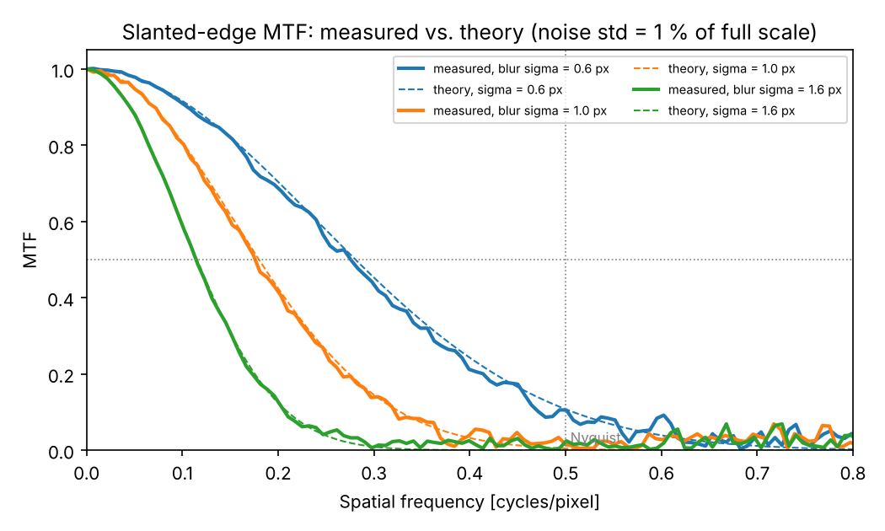
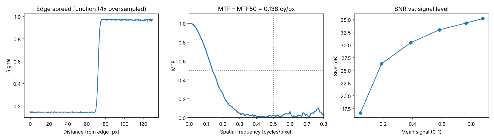

# Camera Image Quality: Slanted-Edge MTF, SNR and Noise

A small Python toolkit that measures the sharpness and noise of a camera from a photo of a printed test chart, the same quantities used to evaluate camera modules in product development:

- **MTF** (modulation transfer function) with the **slanted-edge method** (principle of ISO 12233), reported as **MTF50** and **MTF at Nyquist**
- **SNR and noise** on uniform grey patches, with removal of slow illumination gradients (vignetting) so they are not counted as noise
- **SNR vs. signal level**, which shows how noise depends on brightness (read noise in the dark, shot noise in the bright)

The method is **validated on synthetic images with a known answer** before it is used on real photos.

## How the slanted-edge MTF works

1. A dark square printed at a 5° tilt gives a near-vertical edge.
2. The edge position is found in every pixel row and a straight line is fitted through those positions.
3. Every pixel is projected onto its distance from that line and binned at 1/4 pixel. Because the edge is tilted, different rows sample the edge at different sub-pixel phases, giving a **4x oversampled edge spread function (ESF)**.
4. The derivative of the ESF is the **line spread function (LSF)**; a Hamming window reduces noise at the ends.
5. The **MTF** is the normalised magnitude of the Fourier transform of the LSF, corrected for the finite-difference derivative.

## Validation on synthetic images

Synthetic edge images were rendered at 8x resolution, blurred with a Gaussian of known width (the "lens"), averaged into pixels (the "sensor") and given noise. The true MTF is then known analytically:

MTF(f) = exp(−2π²σ²f²) · |sinc(f)|

| Blur σ [px] | Noise std | Measured angle | MTF50 theory [cy/px] | MTF50 measured | Error |
|---|---|---|---|---|---|
| 0.6 | 0 | 5.00° | 0.281 | 0.276 | −1.7 % |
| 0.6 | 1 % | 5.00° | 0.281 | 0.276 | −1.8 % |
| 0.6 | 3 % | 4.91° | 0.281 | 0.285 | +1.4 % |
| 1.0 | 0 | 5.00° | 0.180 | 0.179 | −0.8 % |
| 1.0 | 1 % | 5.01° | 0.180 | 0.176 | −2.2 % |
| 1.0 | 3 % | 4.99° | 0.180 | 0.175 | −2.7 % |
| 1.6 | 0 | 5.00° | 0.115 | 0.115 | −0.3 % |
| 1.6 | 1 % | 5.00° | 0.115 | 0.114 | −0.9 % |
| 1.6 | 3 % | 4.98° | 0.115 | 0.119 | +2.9 % |

The measured MTF50 is within **±3 %** of theory in all cases, including with 3 % noise.



**SNR check:** grey patches with known noise and a 5 % brightness gradient. With detrending, the measured noise matches the true value (e.g. 0.0091 vs. 0.0091 at 50 % grey); without it, the gradient inflates the noise estimate by up to 50 %.

**One lesson from development:** the first version found the edge with a centroid over the whole row. With 3 % noise this biased the edge angle (5° measured as 3°) and the MTF50 error grew to 55 %. Smoothing only the copy used for edge finding, removing the noise floor, and restricting the centroid to a window around the edge fixed it.

## Project structure

| File | Purpose |
|---|---|
| `imageq.py` | The measurements: slanted-edge MTF and patch SNR (imported by the scripts) |
| `make_chart.py` | Creates the printable A4 test chart in `charts/` |
| `analyze_photo.py` | Measures MTF and SNR from your photo of the chart |
| `synthetic.py` | Synthetic camera images with a known answer |
| `validate_synthetic.py` | Compares measured MTF and SNR with theory, writes `results/` |
| `make_demo_photo.py` | Simulates a camera photo of the chart for a demo |
| `tests/` | Automated PyTest tests, run on every push by GitHub Actions |

## Quick start

```
pip install -r requirements.txt
python make_chart.py                         # print charts/test_chart_A4.pdf at 100 % on matte paper
python analyze_photo.py my_photo.jpg --select
```

With `--select` a window opens: drag a box around one near-vertical side of the dark square (no corners) and press **Enter**, then a box inside each grey patch, pressing **Enter** after each. Press **q** when done. The regions are saved to `my_photo_rois.json` and the report is written to `results/my_photo/`. To repeat the analysis later: `python analyze_photo.py my_photo.jpg --rois my_photo_rois.json`.

**Photographing the chart:** even light without glare, camera parallel to the chart, no digital zoom, the chart filling about a third of the frame, a steady hand or a tripod.

## Tests

```
pytest -q
```

16 tests check that MTF50 matches theory within 5 % for three blur levels and three noise levels, that the edge angle is measured correctly, that an untilted edge is rejected, that edge direction does not change the result, and that SNR ignores an illumination gradient. GitHub Actions runs them automatically on every push.

### Demo on a simulated photo

`make_demo_photo.py` simulates a camera photo of the chart (lens blur, vignetting, brightness-dependent noise); its regions are in `charts/demo_photo_rois.json`. Running `python analyze_photo.py charts/demo_photo.png --rois charts/demo_photo_rois.json` gives:

- Edge angle 5.01°, **MTF50 = 0.138 cycles/pixel**, MTF at Nyquist 0.03
- SNR from 16.6 dB on the darkest patch to 35.2 dB on the brightest, rising with signal as expected when shot noise dominates



## Limitations and next steps

- Monochrome analysis on luminance; per-channel (R, G, B) MTF would reveal chromatic aberration.
- JPEG images from phones are sharpened and denoised by the camera's ISP, so the result describes the whole pipeline, not the lens alone. RAW images (DNG) would isolate the optics and sensor.
- Next steps: MTF across the field (centre vs. corners), distortion from a grid chart, dynamic range from a step chart, and noise power spectrum.

*Author: Mohamed Yosif Abdo – M.Sc. Electrical Engineering (Automation & Robot Technology), DTU*
